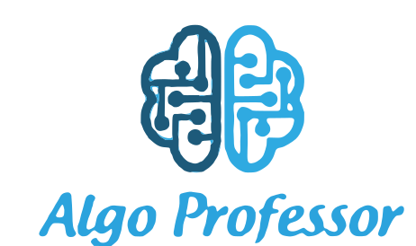

<p align="center">
  
</p>

<h1 align="center">Enterprise AI Product Development Curriculum</h1>

<p align="center"><b>Industry-aligned syllabus · Fifteen courses · Five units each · Curriculum Edition 2026–27</b></p>

<p align="center">
  <a href="https://drssnaiml1-cell.github.io/enterprise-ai-syllabus/"></a>
  <a href="Enterprise_AI_Syllabus.pdf"></a>
  <a href="mailto:cto@algoprofessor.com"></a>
</p>

<p align="center">
  
  
  
  
  
</p>

---

## About

This curriculum prepares learners to **design, build, deploy and govern AI products at enterprise scale**. Ten core AI courses are complemented by a five-course **Emerging Technologies Track**. Every course:

- has **five units**, each ending in a concrete **hands-on outcome** (a working artefact the learner builds);
- pairs **45 lecture hours with 30 hours of tool-driven lab work** (L–T–P–C 3–0–2–4) and **8 labs**;
- maps **five course outcomes to Bloom levels** for OBE, NBA and NAAC documentation;
- ends in an **enterprise capstone product**, with **recommended industry certifications**, aligned careers and the **top three programming languages** for 2026–2035.

Every course follows one arc: **foundations → core methods → advanced methods → production engineering → enterprise deployment, governance and capstone.**

**🌐 Explore it as a website:** **https://drssnaiml1-cell.github.io/enterprise-ai-syllabus/** (searchable, with full unit, lab, outcome, certification, skills and jobs detail for each course, plus career pathways).

## Core AI Track

| # | Code | Course | Product focus | Top 3 languages |
|:-:|:--|:--|:--|:--|
| 1 | `EAI-101` | [Artificial Intelligence](https://drssnaiml1-cell.github.io/enterprise-ai-syllabus/#course-1) | From search and reasoning to enterprise decision intelligence services | Python, Java, C++ |
| 2 | `EAI-102` | [Machine Learning](https://drssnaiml1-cell.github.io/enterprise-ai-syllabus/#course-2) | Building, validating and operating predictive models in production | Python, SQL, R |
| 3 | `EAI-103` | [Deep Learning](https://drssnaiml1-cell.github.io/enterprise-ai-syllabus/#course-3) | Neural architectures engineered for accuracy, scale and efficient inference | Python, C++ / CUDA, Mojo |
| 4 | `EAI-104` | [Reinforcement Learning](https://drssnaiml1-cell.github.io/enterprise-ai-syllabus/#course-4) | Sequential decision-making for optimisation, control and AI alignment | Python, C++, Julia |
| 5 | `EAI-105` | [Computer Vision](https://drssnaiml1-cell.github.io/enterprise-ai-syllabus/#course-5) | Visual perception products for inspection, documents, retail and video analytics | Python, C++, CUDA |
| 6 | `EAI-106` | [Large Language Models](https://drssnaiml1-cell.github.io/enterprise-ai-syllabus/#course-6) | Pre-training, adaptation, retrieval grounding and LLMOps for enterprise language services | Python, TypeScript, Rust |
| 7 | `EAI-107` | [Agentic AI](https://drssnaiml1-cell.github.io/enterprise-ai-syllabus/#course-7) | Autonomous, tool-using and multi-agent systems that execute enterprise workflows | Python, TypeScript, Go |
| 8 | `EAI-108` | [Generative AI](https://drssnaiml1-cell.github.io/enterprise-ai-syllabus/#course-8) | Multimodal generation of text, images, audio, video, code and synthetic data | Python, TypeScript, C++ / CUDA |
| 9 | `EAI-109` | [Data Engineering for AI](https://drssnaiml1-cell.github.io/enterprise-ai-syllabus/#course-9) | Reliable batch, streaming and unstructured-data platforms that feed AI products | SQL, Python, Scala / Java |
| 10 | `EAI-110` | [Trustworthy AI](https://drssnaiml1-cell.github.io/enterprise-ai-syllabus/#course-10) | Fair, explainable, robust, private, secure and regulation-ready AI products | Python, R, Rust |

## Emerging Technologies Track

| # | Code | Course | Product focus | Top 3 languages |
|:-:|:--|:--|:--|:--|
| 11 | `EAI-111` | [Quantum Computing & Quantum AI](https://drssnaiml1-cell.github.io/enterprise-ai-syllabus/#course-11) | Quantum algorithms, quantum machine learning and quantum-safe enterprise systems | Python, OpenQASM 3, C++ |
| 12 | `EAI-112` | [Edge AI, TinyML & AIoT](https://drssnaiml1-cell.github.io/enterprise-ai-syllabus/#course-12) | On-device intelligence for sensors, wearables, vehicles, factories and smart infrastructure | C++, Python, Rust |
| 13 | `EAI-113` | [Physical AI & Intelligent Robotics](https://drssnaiml1-cell.github.io/enterprise-ai-syllabus/#course-13) | Embodied AI that perceives, plans and acts in the physical world | C++, Python, Rust |
| 14 | `EAI-114` | [AI-Driven Cybersecurity](https://drssnaiml1-cell.github.io/enterprise-ai-syllabus/#course-14) | Machine learning and agents for threat detection, response and secure enterprises | Python, Go, Rust |
| 15 | `EAI-115` | [Blockchain & Decentralised AI](https://drssnaiml1-cell.github.io/enterprise-ai-syllabus/#course-15) | Verifiable data, model provenance and decentralised trust for AI ecosystems | Solidity, Rust, Go |

## Skills & Jobs by Course

Every course ends with job-ready skills and a GitHub portfolio (five unit artefacts, eight lab projects and an enterprise capstone). Click a course to see its full skills list and the jobs it prepares learners for.

<details>
<summary><b>1. Artificial Intelligence</b> (EAI-101): AI Engineer, Decision Scientist, Optimisation Engineer …</summary>

**Skills you will gain**

- Framing business problems as search, optimisation, planning or inference tasks
- Pathfinding and heuristic search (A*, MCTS) for routing and games
- Scheduling and resource allocation with OR-Tools, PuLP and constraint solvers
- Building enterprise knowledge graphs in Neo4j with Cypher and SPARQL
- Rule engines and explainable, auditable reasoning
- Bayesian networks and decision-making under uncertainty
- Automated planning with PDDL and hierarchical task networks
- Shipping AI logic as tested FastAPI + Docker microservices

**Jobs you can apply for**

| Job role | Level | What the role does |
|:--|:--|:--|
| **AI Engineer** | Fresher / Entry | Builds and integrates AI decision components into products and internal tools. |
| **Decision Scientist** | Fresher / Entry | Turns business questions into optimisation and probabilistic decision models. |
| **Optimisation Engineer** | 2–5 yrs | Designs schedulers, routers and allocation engines that cut cost and time. |
| **Knowledge Graph Engineer** | 2–5 yrs | Models enterprise data as graphs that power search, recommendations and GraphRAG. |
| **AI Product Manager** | 2–5 yrs | Scopes AI use-cases, defines KPIs and ROI, and steers build-vs-buy decisions. |
| **AI Solutions Architect** | Senior | Designs end-to-end decision-intelligence platforms for enterprise clients. |

**Who hires:** Logistics & supply chain, banking & insurance, consulting, e-commerce, telecom, government tech

**Capstone for your portfolio:** Enterprise Decision-Intelligence Engine

</details>

<details>
<summary><b>2. Machine Learning</b> (EAI-102): Data Scientist, Machine Learning Engineer, Analytics Engineer …</summary>

**Skills you will gain**

- Translating business KPIs into ML targets, labels and metrics
- Feature engineering and data preparation with pandas and scikit-learn
- Gradient-boosted models (XGBoost, LightGBM) for tabular data
- Clustering, dimensionality reduction and anomaly detection
- Model evaluation, cross-validation and hyperparameter tuning
- Explaining predictions with SHAP and fairness checks
- Experiment tracking and model registry with MLflow
- Serving and monitoring models through MLOps pipelines (CI/CD, drift)

**Jobs you can apply for**

| Job role | Level | What the role does |
|:--|:--|:--|
| **Data Scientist** | Fresher / Entry | Builds predictive models and insights that drive product and business decisions. |
| **Machine Learning Engineer** | Fresher / Entry | Takes models from notebooks to reliable, scalable production services. |
| **Analytics Engineer** | Fresher / Entry | Builds clean, modelled datasets and metrics layers that ML and BI depend on. |
| **MLOps Engineer** | 2–5 yrs | Automates training, deployment, monitoring and retraining of ML models. |
| **Applied Scientist** | Senior | Invents and validates new ML methods for high-impact product problems. |

**Who hires:** Fintech & banking, retail & e-commerce, healthcare, SaaS, analytics consultancies, GCCs (global capability centres)

**Capstone for your portfolio:** Customer Intelligence Platform

</details>

<details>
<summary><b>3. Deep Learning</b> (EAI-103): Deep Learning Engineer, AI Research Engineer, ML Performance Engineer …</summary>

**Skills you will gain**

- Building and training neural networks in PyTorch from first principles
- Optimisers, regularisation and training stability
- CNNs, RNNs/LSTMs and sequence modelling
- Transformers, attention and graph neural networks
- Transfer learning and fine-tuning pre-trained models
- Mixed-precision and distributed GPU training
- Model compression: quantisation, pruning and distillation
- High-performance inference with ONNX, TensorRT and Triton

**Jobs you can apply for**

| Job role | Level | What the role does |
|:--|:--|:--|
| **Deep Learning Engineer** | Fresher / Entry | Designs, trains and tunes neural networks for vision, text and signals. |
| **AI Research Engineer** | 2–5 yrs | Turns research papers into working, benchmarked model implementations. |
| **ML Performance Engineer** | 2–5 yrs | Speeds up training and inference on GPUs through profiling and optimisation. |
| **Edge AI Engineer** | 2–5 yrs | Compresses and deploys deep models onto phones, cameras and devices. |
| **Applied Scientist** | Senior | Leads novel deep-learning solutions from experiment to product. |

**Who hires:** AI product companies, semiconductor & GPU firms, healthcare imaging, autonomous systems, big-tech research labs

**Capstone for your portfolio:** Deep Learning Inference Service

</details>

<details>
<summary><b>4. Reinforcement Learning</b> (EAI-104): Reinforcement Learning Engineer, Decision Scientist, Robotics AI Engineer …</summary>

**Skills you will gain**

- Modelling sequential decisions as Markov decision processes
- Dynamic programming, Q-learning and SARSA
- Deep RL: DQN, PPO and actor-critic methods
- Reward design, exploration and training stability
- Offline RL and learning from logged business data
- Multi-agent and safe reinforcement learning
- RLHF and DPO for aligning large language models
- Simulation environments with Gymnasium and RL libraries

**Jobs you can apply for**

| Job role | Level | What the role does |
|:--|:--|:--|
| **Reinforcement Learning Engineer** | Fresher / Entry | Builds agents that learn policies for control, pricing or recommendation. |
| **Decision Scientist** | Fresher / Entry | Optimises sequential business decisions such as inventory, bidding and pricing. |
| **Robotics AI Engineer** | 2–5 yrs | Trains robot behaviours in simulation and transfers them to hardware. |
| **LLM Alignment Engineer** | 2–5 yrs | Uses RLHF and preference optimisation to make LLMs helpful and safe. |
| **Operations Research Scientist** | Senior | Combines RL with optimisation for large-scale planning problems. |

**Who hires:** Robotics, gaming, ad-tech & recommendation, energy & grids, quant finance, LLM labs

**Capstone for your portfolio:** Adaptive Pricing and Inventory Optimiser

</details>

<details>
<summary><b>5. Computer Vision</b> (EAI-105): Computer Vision Engineer, Document AI Engineer, Video Analytics Engineer …</summary>

**Skills you will gain**

- Image processing, camera calibration and geometric vision with OpenCV
- Image classification and transfer learning
- Object detection, segmentation and multi-object tracking (YOLO-class models)
- Document AI: OCR and layout understanding
- Video analytics and 3D vision
- Vision–language models for search and inspection
- Dataset annotation, augmentation and evaluation metrics (mAP, IoU)
- Real-time edge deployment with privacy safeguards

**Jobs you can apply for**

| Job role | Level | What the role does |
|:--|:--|:--|
| **Computer Vision Engineer** | Fresher / Entry | Builds detection, segmentation and recognition systems for real cameras. |
| **Document AI Engineer** | Fresher / Entry | Automates reading of invoices, forms and records with OCR and layout models. |
| **Video Analytics Engineer** | 2–5 yrs | Delivers real-time video understanding for safety, retail and traffic. |
| **Edge AI Engineer** | 2–5 yrs | Runs vision models efficiently on Jetson-class and embedded devices. |
| **Perception Engineer (Robotics/Autonomy)** | Senior | Builds the vision stack that lets robots and vehicles understand the world. |

**Who hires:** Manufacturing & quality inspection, retail analytics, smart cities, healthcare imaging, automotive, banking (document AI)

**Capstone for your portfolio:** Smart Visual Inspection System

</details>

<details>
<summary><b>6. Large Language Models</b> (EAI-106): LLM Engineer, AI Engineer (GenAI), NLP Engineer …</summary>

**Skills you will gain**

- How transformers and tokenisers work inside an LLM
- Prompt engineering, reasoning patterns and structured (JSON) outputs
- Fine-tuning with LoRA/QLoRA on domain data
- Retrieval-augmented generation with embeddings and vector databases
- LLM evaluation: accuracy, faithfulness, safety and cost
- Guardrails against hallucination and prompt injection
- Serving LLMs efficiently (vLLM, quantisation, caching)
- LLMOps: tracing, versioning and production monitoring

**Jobs you can apply for**

| Job role | Level | What the role does |
|:--|:--|:--|
| **LLM Engineer** | Fresher / Entry | Builds chat, search and summarisation features on top of large language models. |
| **AI Engineer (GenAI)** | Fresher / Entry | Integrates LLM APIs and open models into company products and workflows. |
| **NLP Engineer** | Fresher / Entry | Solves text classification, extraction and translation, including Indian languages. |
| **Search & Retrieval Engineer** | 2–5 yrs | Designs RAG pipelines, embeddings and vector search that ground LLM answers. |
| **Conversational AI Developer** | 2–5 yrs | Builds reliable customer-facing assistants and voice/chat bots. |
| **LLMOps Engineer** | 2–5 yrs | Runs, evaluates and cost-optimises LLMs in production. |

**Who hires:** Every enterprise adopting GenAI: IT services & GCCs, banking, legal, healthcare, edtech, SaaS and AI start-ups

**Capstone for your portfolio:** Enterprise Knowledge Assistant

</details>

<details>
<summary><b>7. Agentic AI</b> (EAI-107): Agentic AI Engineer, Forward-Deployed AI Engineer, AI Automation Architect …</summary>

**Skills you will gain**

- Designing agents that plan, use tools, keep memory and recover from errors
- Choosing between workflows, single agents and multi-agent systems
- Agent frameworks (LangGraph and similar) and agent SDKs
- Tool integration through MCP servers and secure APIs
- Multi-agent orchestration and hand-offs
- Agent evaluation, tracing and observability
- Human-in-the-loop approval and sandboxing for safe autonomy
- Deploying agent platforms with cost, latency and reliability controls

**Jobs you can apply for**

| Job role | Level | What the role does |
|:--|:--|:--|
| **Agentic AI Engineer** | Fresher / Entry | Builds tool-using AI agents that complete real business tasks end to end. |
| **Forward-Deployed AI Engineer** | Fresher / Entry | Works on-site with clients to design and ship agents for their workflows. |
| **AI Automation Architect** | 2–5 yrs | Redesigns business processes around agents with approvals and audit trails. |
| **AI Platform Engineer** | 2–5 yrs | Builds the shared agent infrastructure: tools, memory, evaluation and guardrails. |
| **AI Product Manager** | 2–5 yrs | Defines agent products, success metrics and safe levels of autonomy. |
| **AI Solutions Architect** | Senior | Designs enterprise-wide agentic systems integrated with existing IT. |

**Who hires:** IT services & consulting, SaaS, banking operations, customer support, enterprise automation and AI-first start-ups

**Capstone for your portfolio:** Autonomous Operations Copilot

</details>

<details>
<summary><b>8. Generative AI</b> (EAI-108): Generative AI Developer, Generative AI Engineer, Synthetic Data Engineer …</summary>

**Skills you will gain**

- Generative model families: VAEs, GANs, diffusion and autoregressive models
- Controllable image generation (conditioning, ControlNet, LoRA styles)
- Multimodal generation across text, image, audio and video
- Code generation and synthetic data for training and testing
- Evaluating generative quality, diversity and bias
- Watermarking, provenance and content safety
- Building GenAI product features with front-end delivery
- Responsible-use, copyright and governance practices

**Jobs you can apply for**

| Job role | Level | What the role does |
|:--|:--|:--|
| **Generative AI Developer** | Fresher / Entry | Builds apps that generate text, images, audio or code for users. |
| **Generative AI Engineer** | Fresher / Entry | Fine-tunes and deploys generative models behind product features. |
| **Synthetic Data Engineer** | 2–5 yrs | Creates privacy-safe synthetic datasets to train and test AI systems. |
| **Multimodal AI Engineer** | 2–5 yrs | Combines vision, language and audio models in a single product. |
| **Creative Technologist** | 2–5 yrs | Uses generative AI to prototype campaigns, designs and interactive experiences. |
| **AI Research Engineer** | Senior | Advances generative architectures and their evaluation. |

**Who hires:** Media & advertising, design and creative tools, gaming, e-commerce content, edtech, synthetic-data and AI start-ups

**Capstone for your portfolio:** AI Creative & Synthetic-Data Studio

</details>

<details>
<summary><b>9. Data Engineering for AI</b> (EAI-109): Data Engineer, Analytics Engineer, AI Data Engineer …</summary>

**Skills you will gain**

- Data modelling, SQL and warehouse design
- Batch pipelines with Apache Spark and lakehouse tables
- Streaming data with Kafka and real-time processing
- Orchestration with Airflow-class tools and dbt transformations
- Feature stores for ML training and serving
- Unstructured data pipelines and vector stores for LLMs
- Data quality testing, lineage and governance
- Cloud data platforms (Databricks, Snowflake, AWS, Azure, GCP)

**Jobs you can apply for**

| Job role | Level | What the role does |
|:--|:--|:--|
| **Data Engineer** | Fresher / Entry | Builds the reliable batch and streaming pipelines every AI product depends on. |
| **Analytics Engineer** | Fresher / Entry | Models raw data into trusted tables and metrics with SQL and dbt. |
| **AI Data Engineer** | 2–5 yrs | Prepares features, documents and embeddings for ML and LLM systems. |
| **Streaming Engineer** | 2–5 yrs | Runs real-time event pipelines for fraud, IoT and personalisation. |
| **DataOps Engineer** | 2–5 yrs | Automates testing, deployment and monitoring of data pipelines. |
| **Data Platform Architect** | Senior | Designs the company-wide lakehouse, governance and data strategy. |

**Who hires:** Every data-driven company: banks, telecom, retail, GCCs, cloud and consulting firms, product start-ups

**Capstone for your portfolio:** AI-Ready Enterprise Data Platform

</details>

<details>
<summary><b>10. Trustworthy AI</b> (EAI-110): Responsible AI Specialist, AI Red-Team Engineer, AI Security Engineer …</summary>

**Skills you will gain**

- AI risk assessment and impact analysis
- Measuring and mitigating bias and unfairness
- Explainability methods for models and LLMs
- Robustness, privacy (differential privacy) and safety testing
- Security for AI: prompt injection, data poisoning, model theft
- Red-teaming AI systems and LLMs
- Model cards, documentation and audit evidence
- Regulation and standards: EU AI Act, ISO/IEC 42001, NIST AI RMF, DPDP Act

**Jobs you can apply for**

| Job role | Level | What the role does |
|:--|:--|:--|
| **Responsible AI Specialist** | Fresher / Entry | Tests models for fairness, explainability and safety before release. |
| **AI Red-Team Engineer** | 2–5 yrs | Attacks AI systems to find jailbreaks, leaks and unsafe behaviour first. |
| **AI Security Engineer** | 2–5 yrs | Secures models, data and AI pipelines against modern AI-specific threats. |
| **AI Auditor** | 2–5 yrs | Assesses AI systems against regulations, standards and company policy. |
| **AI Risk Manager** | Senior | Owns the AI risk register and controls across the organisation. |
| **AI Governance & Compliance Lead** | Senior | Leads AI policy, approvals and regulatory readiness. |

**Who hires:** Banks & insurers, big tech, Big-4 and consulting, healthcare, government and regulators, AI-assurance firms

**Capstone for your portfolio:** Responsible-AI Assurance Toolkit

</details>

<details>
<summary><b>11. Quantum Computing & Quantum AI</b> (EAI-111): Quantum Software Engineer, Quantum Algorithm Developer, Quantum ML Researcher …</summary>

**Skills you will gain**

- Qubits, gates, circuits and measurement
- Programming quantum circuits in Qiskit and OpenQASM
- Core quantum algorithms (Grover, QFT, phase estimation)
- Variational algorithms: VQE and QAOA on NISQ hardware
- Quantum machine learning and quantum kernels
- Running jobs on real quantum hardware and simulators
- Hybrid quantum–classical optimisation for business problems
- Post-quantum cryptography and crypto-agility planning

**Jobs you can apply for**

| Job role | Level | What the role does |
|:--|:--|:--|
| **Quantum Software Engineer** | Fresher / Entry | Writes and optimises quantum circuits and hybrid quantum–classical code. |
| **Quantum Algorithm Developer** | 2–5 yrs | Designs quantum algorithms for optimisation, chemistry and finance. |
| **Quantum ML Researcher** | 2–5 yrs | Explores quantum-enhanced machine learning and benchmarks it honestly. |
| **Post-Quantum Cryptography Engineer** | 2–5 yrs | Migrates systems to quantum-safe cryptography. |
| **Quantum Solutions Consultant** | Senior | Identifies where quantum adds value and plans enterprise roadmaps. |

**Who hires:** Quantum start-ups, IBM/Google-class labs, banks & fintech, pharma & materials, defence and National Quantum Mission projects

**Capstone for your portfolio:** Hybrid Quantum Optimisation Service

</details>

<details>
<summary><b>12. Edge AI, TinyML & AIoT</b> (EAI-112): Embedded ML Engineer, TinyML Engineer, Edge AI Engineer …</summary>

**Skills you will gain**

- AIoT and edge–cloud architectures
- Sensor data acquisition and signal processing
- Embedded ML on microcontrollers (TinyML)
- Model quantisation and optimisation for constrained devices
- On-device generative AI and small language models
- Federated learning for privacy-preserving training
- Edge MLOps: OTA updates and fleet monitoring
- Securing devices, firmware and edge models

**Jobs you can apply for**

| Job role | Level | What the role does |
|:--|:--|:--|
| **Embedded ML Engineer** | Fresher / Entry | Puts machine learning into firmware on microcontrollers and sensors. |
| **TinyML Engineer** | Fresher / Entry | Builds ultra-low-power models for wearables and battery devices. |
| **Edge AI Engineer** | 2–5 yrs | Optimises and deploys AI on gateways, cameras and edge servers. |
| **IoT Platform Engineer** | 2–5 yrs | Runs device fleets, connectivity and edge MLOps at scale. |
| **AIoT Solutions Architect** | Senior | Designs complete sensor-to-cloud AI solutions for industry. |

**Who hires:** Semiconductors & chip firms, consumer electronics, automotive, industrial IoT, agritech, smart-city and medical-device companies

**Capstone for your portfolio:** Predictive Maintenance AIoT System

</details>

<details>
<summary><b>13. Physical AI & Intelligent Robotics</b> (EAI-113): Robotics Software Engineer, Physical AI Engineer, Simulation & Digital Twin Engineer …</summary>

**Skills you will gain**

- Robot kinematics, dynamics and control
- Robot software engineering with ROS 2
- Perception, SLAM, localisation and navigation
- Motion planning for arms, mobile robots and drones
- Robot learning: imitation and reinforcement learning
- Simulation and digital twins (Isaac Sim, Gazebo)
- Sim-to-real transfer and safety testing
- Robot foundation models and vision–language–action policies

**Jobs you can apply for**

| Job role | Level | What the role does |
|:--|:--|:--|
| **Robotics Software Engineer** | Fresher / Entry | Builds ROS 2 software that makes robots sense, plan and act. |
| **Physical AI Engineer** | Fresher / Entry | Brings AI models into machines that work in the real world. |
| **Simulation & Digital Twin Engineer** | 2–5 yrs | Creates virtual factories and robots to train and test before deployment. |
| **Autonomy / Perception Engineer** | 2–5 yrs | Builds the perception and navigation stack for autonomous systems. |
| **Robot Learning Engineer** | Senior | Trains robot policies with imitation, RL and foundation models. |

**Who hires:** Warehouse & logistics automation, manufacturing, drones, automotive & autonomous vehicles, healthcare robotics, defence

**Capstone for your portfolio:** Autonomous Warehouse Assistant

</details>

<details>
<summary><b>14. AI-Driven Cybersecurity</b> (EAI-114): AI Security Analyst, Detection Engineer, Security Data Scientist …</summary>

**Skills you will gain**

- Security fundamentals: networks, threats and MITRE ATT&CK
- ML for intrusion, malware, phishing and fraud detection
- Graph and deep learning for attack and anomaly analysis
- Building detections on SIEM/SOC log data
- LLM copilots and agents for SOC automation
- Threat intelligence analysis with AI
- Adversarial robustness of security models
- Compliance and secure deployment of AI in security

**Jobs you can apply for**

| Job role | Level | What the role does |
|:--|:--|:--|
| **AI Security Analyst** | Fresher / Entry | Uses AI tools to triage alerts and investigate incidents in a SOC. |
| **Detection Engineer** | Fresher / Entry | Writes and tunes ML and rule-based detections for real attacks. |
| **Security Data Scientist** | 2–5 yrs | Builds models that spot fraud, intrusions and insider threats. |
| **SOC Automation Engineer** | 2–5 yrs | Automates response playbooks with LLM agents and SOAR. |
| **Threat Intelligence Analyst** | 2–5 yrs | Uses AI to track attackers, campaigns and emerging threats. |

**Who hires:** SOCs and MSSPs, banks & fintech, cybersecurity product firms, telecom, government CERTs, Big-4 cyber practices

**Capstone for your portfolio:** AI-Augmented Security Operations Centre

</details>

<details>
<summary><b>15. Blockchain & Decentralised AI</b> (EAI-115): Blockchain Developer, Web3 + AI Engineer, Smart Contract Auditor …</summary>

**Skills you will gain**

- Blockchain fundamentals: consensus, cryptography and ledgers
- Smart contracts in Solidity and secure dApp development
- Smart-contract testing and security auditing
- Permissioned enterprise blockchains (Hyperledger Fabric)
- Decentralised identity and verifiable credentials
- IPFS and decentralised storage
- Dataset and model provenance on-chain for trustworthy AI
- Designing governance for decentralised AI systems

**Jobs you can apply for**

| Job role | Level | What the role does |
|:--|:--|:--|
| **Blockchain Developer** | Fresher / Entry | Builds smart contracts and decentralised applications. |
| **Web3 + AI Engineer** | Fresher / Entry | Combines AI services with blockchain for verifiable, decentralised products. |
| **Smart Contract Auditor** | 2–5 yrs | Finds vulnerabilities in contracts before they hold real value. |
| **AI Provenance Engineer** | 2–5 yrs | Records data and model lineage so any AI decision can be traced. |
| **Decentralised Identity Architect** | Senior | Designs verifiable credential and identity systems for enterprises. |

**Who hires:** Fintech & banking, supply chain & traceability, Web3 start-ups, government (land, certificates), audit and consulting firms

**Capstone for your portfolio:** Verifiable AI Supply-Chain Ledger

</details>

## Career Pathways

Which courses make a learner job-ready for each role (core courses, plus recommended extras):

| Target role | Core courses | Recommended extras | |
|:--|:--|:--|:--|
| **AI / ML Engineer** | 1. Artificial Intelligence, 2. Machine Learning, 3. Deep Learning, 9. Data Engineering for AI | Large Language Models | The most-hired AI role: builds, ships and maintains models in production. |
| **LLM & Generative AI Engineer** | 3. Deep Learning, 6. Large Language Models, 8. Generative AI | Agentic AI, Trustworthy AI | Builds GenAI features, RAG systems and fine-tuned models for enterprises. |
| **Agentic AI Engineer** | 6. Large Language Models, 7. Agentic AI, 10. Trustworthy AI | Artificial Intelligence, Data Engineering for AI | Designs tool-using, multi-agent systems with human oversight. |
| **Data Scientist** | 2. Machine Learning, 9. Data Engineering for AI | Deep Learning, Trustworthy AI | Turns data into predictive models and decisions the business can trust. |
| **Data / MLOps Engineer** | 9. Data Engineering for AI, 2. Machine Learning | Large Language Models | Owns the pipelines, platforms and monitoring behind every AI product. |
| **Computer Vision & Edge AI Engineer** | 3. Deep Learning, 5. Computer Vision, 12. Edge AI, TinyML & AIoT | Physical AI & Intelligent Robotics | Puts real-time vision on cameras, devices and machines. |
| **Robotics / Physical AI Engineer** | 4. Reinforcement Learning, 5. Computer Vision, 13. Physical AI & Intelligent Robotics | Edge AI, TinyML & AIoT | Makes robots and drones perceive, plan and learn. |
| **AI Security Engineer** | 10. Trustworthy AI, 14. AI-Driven Cybersecurity | Large Language Models, Agentic AI | Protects AI systems and uses AI to defend the enterprise. |
| **Responsible AI & Governance Lead** | 10. Trustworthy AI, 2. Machine Learning | Blockchain & Decentralised AI | Keeps AI fair, explainable, compliant and auditable. |
| **Quantum Software Engineer** | 11. Quantum Computing & Quantum AI, 2. Machine Learning | Deep Learning | Builds hybrid quantum–classical solutions and quantum-safe systems. |
| **Blockchain + AI Engineer** | 15. Blockchain & Decentralised AI, 10. Trustworthy AI | Data Engineering for AI | Builds verifiable data, model provenance and decentralised trust. |
| **AI Product Manager / Solutions Architect** | 1. Artificial Intelligence, 7. Agentic AI, 10. Trustworthy AI | Large Language Models, Data Engineering for AI | Leads AI products and enterprise architectures from idea to ROI. |

## Assessment Scheme (per course)

| Component | Weight |
|:--|:-:|
| Continuous lab work & notebooks | 20% |
| Two mid-term evaluations | 20% |
| Mini-project / sprint reviews | 20% |
| Enterprise capstone (demo + report) | 40% |

## For Universities: AlgoProfessor Consultancy

AlgoProfessor supports institutions from adoption to industry-ready graduates: curriculum customisation, faculty development programmes, AI and emerging-tech lab set-up, GitHub course repositories, industry capstones, certification readiness, a Centre of Excellence in AI, research and Q1 publications, accreditation and ranking support, and placement readiness.

| Engagement model | Scope | Best suited for |
|:--|:--|:--|
| **Pilot** | One or two courses, FDP, lab manual and GitHub repository for one department | Departments starting their AI journey |
| **Department Programme** | Full core AI track (10 courses) with labs, capstones and certification preparation | AI & DS, CSE and allied departments |
| **University Transformation** | All 15 courses, Centre of Excellence, research and accreditation support across schools | Universities aiming for AI leadership |

**Vice-Chancellors, Deans and HoDs:** contact **[cto@algoprofessor.com](mailto:cto@algoprofessor.com)** to schedule a curriculum consultation · [www.algoprofessor.com](https://www.algoprofessor.com) · [campus.algoprofessor.com](https://campus.algoprofessor.com)

## Repository Layout

```
index.html                  the website (GitHub Pages)
Enterprise_AI_Syllabus.pdf  the complete 55-page syllabus
data/courses.json           structured data for all 15 courses
data/careers.json           skills, jobs, employers and career pathways
src/template.html           website template
scripts/parse.py            extracts course data from the syllabus text
scripts/build.py            builds index.html from the template and data
assets/                     AlgoProfessor logo
```

To rebuild the site after editing `data/courses.json`, `data/careers.json` or the template:

```bash
python3 scripts/build.py data/courses.json src/template.html index.html
```

## Author

**Dr S Satyanarayana** Ph.D., PDF(AI), FARSC
Founder, CEO & Chief Agentic AI Scientist, AlgoProfessor AI R&D Solutions, Hyderabad
International Postdoctoral Research Co-Supervisor, NYUST (YunTech) & NKUST, Taiwan
[GitHub](https://github.com/drssnaiml1-cell) · [ceo@algoprofessor.com](mailto:ceo@algoprofessor.com)

---

<p align="center"><sub>© 2026 Dr S Satyanarayana, AlgoProfessor AI R&amp;D Solutions. All rights reserved.</sub></p>
