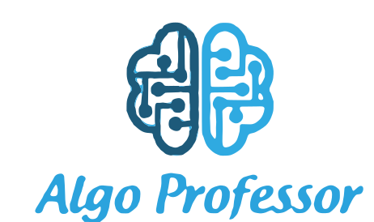
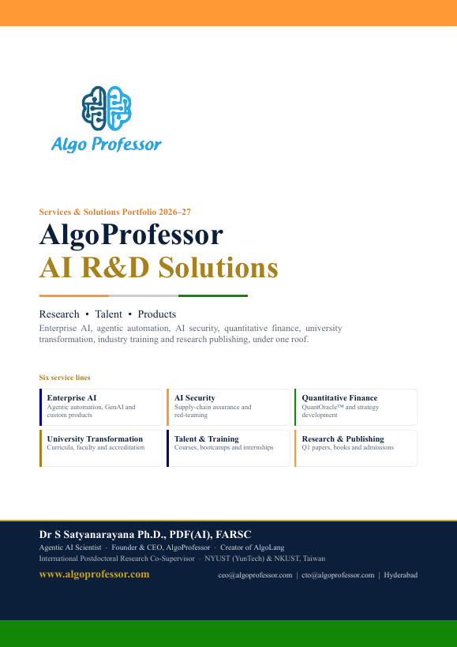
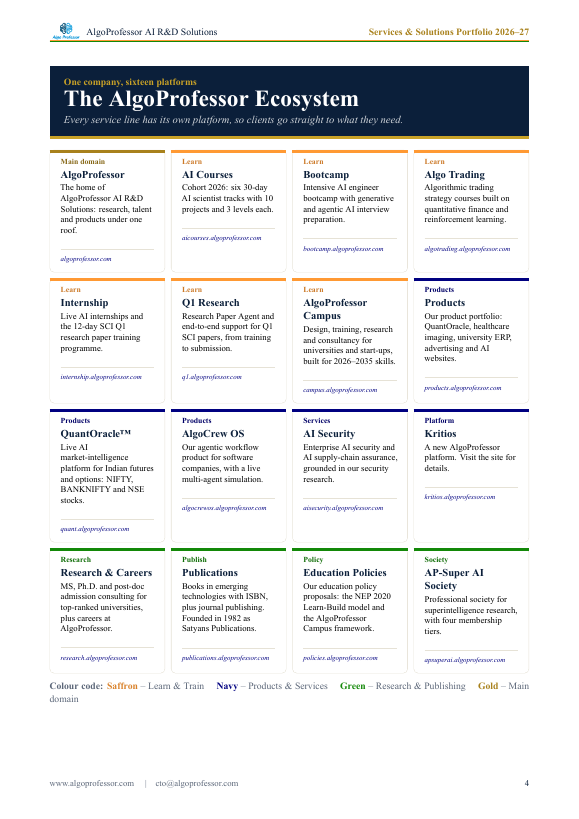
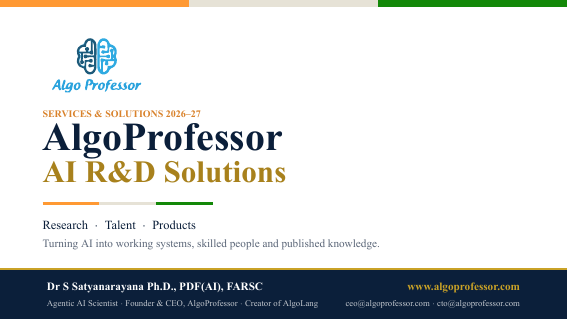
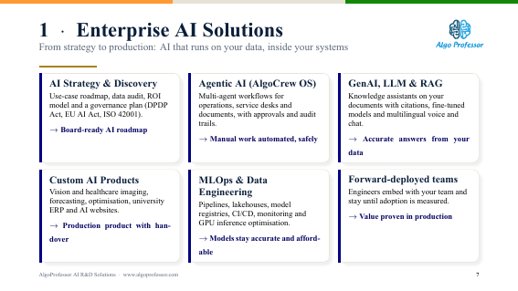

<p align="center"></p>

<h1 align="center">AlgoProfessor AI R&amp;D Solutions</h1>

<p align="center"><b>Services &amp; Solutions Portfolio 2026–27</b><br>Research · Talent · Products</p>

<p align="center">
  <a href="AlgoProfessor_Services_Brochure.pdf"></a>
  <a href="AlgoProfessor_Services_Deck.pdf"></a>
  <a href="https://www.algoprofessor.com"></a>
  <a href="mailto:cto@algoprofessor.com"></a>
</p>

AlgoProfessor AI R&D Solutions is a Hyderabad-based artificial intelligence research, engineering and education company. We help enterprises, universities, start-ups and researchers turn AI into **working systems**, **skilled people** and **published knowledge**.

This folder holds the company's client-facing materials: a corporate **brochure** and a matching **16:9 slide deck**, both written in LaTeX, set in Times New Roman, and styled in AlgoProfessor's navy-and-gold palette with Indian-tricolour accents.

## What's Inside

| Document | Format | Best used for |
|:--|:--|:--|
| [**Services & Solutions Brochure**](AlgoProfessor_Services_Brochure.pdf) | 12-page A4 PDF · [LaTeX source](brochure/) | Emailing to clients, printing, leaving after a meeting |
| [**Services & Solutions Deck**](AlgoProfessor_Services_Deck.pdf) | 18-slide 16:9 PDF · [LaTeX source](deck/) | Presenting to leadership teams, VCs, Deans and partners |

<table>
<tr>
<td width="50%"><a href="AlgoProfessor_Services_Brochure.pdf"></a><br><sub><b>Brochure:</b> cover with the six service lines</sub></td>
<td width="50%"><a href="AlgoProfessor_Services_Brochure.pdf"></a><br><sub><b>Brochure:</b> the 16-platform ecosystem</sub></td>
</tr>
<tr>
<td><a href="AlgoProfessor_Services_Deck.pdf"></a><br><sub><b>Deck:</b> title slide</sub></td>
<td><a href="AlgoProfessor_Services_Deck.pdf"></a><br><sub><b>Deck:</b> Enterprise AI Solutions</sub></td>
</tr>
</table>

## Six Service Lines

| # | Service line | What clients get |
|:-:|:--|:--|
| 1 | **Enterprise AI Solutions** | AI strategy, agentic workflow automation (AlgoCrew OS), GenAI / LLM / RAG assistants, custom AI products, MLOps and forward-deployed teams |
| 2 | **AI Security & Trustworthy AI** | AI supply-chain assurance, red-teaming, runtime guardrails and responsible-AI governance (EU AI Act, NIST AI RMF, ISO/IEC 42001, DPDP Act) |
| 3 | **Quantitative Finance** | QuantOracle™ market intelligence for Indian F&O, backtested strategy development on Tradetron, and quant training |
| 4 | **University Transformation** | Industry-aligned curricula, faculty development, GitHub course repositories, One Student One Project, NBA / NAAC / NIRF / QS / THE support |
| 5 | **Talent & Training** | Cohort 2026 AI courses, the Sunday AI-to-Agentic-AI-Scientist programme, bootcamps, 90-day internships and corporate training |
| 6 | **Research & Publishing** | SCI Q1 paper training, Research Paper Agent, sponsored research, AlgoProfessor Publications, admissions consulting and ProfAlgoLabs™ |

## The AlgoProfessor Ecosystem

| Learn & train | Products & services | Research & publishing |
|:--|:--|:--|
| [AI Courses](https://aicourses.algoprofessor.com) | [Products](https://products.algoprofessor.com) | [Research & Careers](https://research.algoprofessor.com) |
| [Bootcamp](https://bootcamp.algoprofessor.com) | [QuantOracle™](https://quant.algoprofessor.com) | [Publications](https://publications.algoprofessor.com) |
| [Algo Trading](https://algotrading.algoprofessor.com) | [AlgoCrew OS](https://algocrewos.algoprofessor.com) | [Education Policies](https://policies.algoprofessor.com) |
| [Internship](https://internship.algoprofessor.com) | [AI Security](https://aisecurity.algoprofessor.com) | [AP-Super AI Society](https://apsuperai.algoprofessor.com) |
| [Q1 Research](https://q1.algoprofessor.com) | [Kritios](https://kritios.algoprofessor.com) | |
| [AlgoProfessor Campus](https://campus.algoprofessor.com) | | |

Main domain: **[www.algoprofessor.com](https://www.algoprofessor.com)**

## At a Glance

| 16 | 56 | 60+ | 11+ | 11 | 22 | 1982 |
|:-:|:-:|:-:|:-:|:-:|:-:|:-:|
| digital platforms | Ph.D. & post-doc scholars mentored | indexed publications | patents | books | years of R&D | publishing legacy |

## How We Work

**Discover → Design → Build → Deploy → Scale.** Every engagement includes source code and documentation, a security and compliance review, training and handover, a KPI dashboard, weekly progress reviews and post-launch support. Engagements can start as a 4–8 week proof of concept, a fixed-scope project, a dedicated forward-deployed team, a training programme or a strategic partnership.

## Design System

| Role | Colour | Hex |
|:--|:--|:--|
| Primary (authority) | Navy | `#0B1F3A` |
| Accent (excellence) | Gold | `#A8811C` |
| Learn & train | Saffron | `#FF9933` |
| Research & publishing | India green | `#138808` |
| Products & services | Deep navy | `#000080` |
| Body text / muted / lines | Ink / slate / sand | `#1E293B` / `#5B6678` / `#E6E2D6` |

Typeface: **Times New Roman** throughout. Quotations used in both documents: Alan Turing, Alan Kay, Bruce Schneier, Warren Buffett, Nelson Mandela, Swami Vivekananda and Dr A. P. J. Abdul Kalam.

## Build from Source

Both documents compile with **XeLaTeX** (TeX Live 2023 or later) and use Times New Roman when it is installed (standard on Windows and macOS), with TeX Gyre Termes as a fallback.

```bash
cd algoprofessor/brochure && xelatex AlgoProfessor_Services_Brochure.tex && xelatex AlgoProfessor_Services_Brochure.tex
cd ../deck              && xelatex AlgoProfessor_Services_Deck.tex     && xelatex AlgoProfessor_Services_Deck.tex
```

Copy the resulting PDFs up one level to update the published versions. Each folder includes `algoprofessor-logo.pdf`, so it builds on its own.

## Leadership

**Dr S Satyanarayana** Ph.D., PDF(AI), FARSC
Agentic AI Scientist · Founder & CEO, AlgoProfessor · Creator of AlgoLang
International Postdoctoral Research Co-Supervisor · NYUST (YunTech) & NKUST, Taiwan

## Contact

| For | Email |
|:--|:--|
| Partnerships, enterprise AI, AI security, internships | [cto@algoprofessor.com](mailto:cto@algoprofessor.com) |
| Leadership, research, publications, universities | [ceo@algoprofessor.com](mailto:ceo@algoprofessor.com) |
| Products and demos | [product@algoprofessor.com](mailto:product@algoprofessor.com) |
| Courses and admissions | [aicourses@algoprofessor.com](mailto:aicourses@algoprofessor.com) |
| General enquiries | [contact@algoprofessor.com](mailto:contact@algoprofessor.com) |

---

<p align="center"><sub>© 2026 AlgoProfessor AI R&amp;D Solutions, Hyderabad. All rights reserved. QuantOracle, AlgoCrew OS and ProfAlgoLabs are AlgoProfessor product names. Trading involves market risk; backtests do not guarantee future returns.</sub></p>
