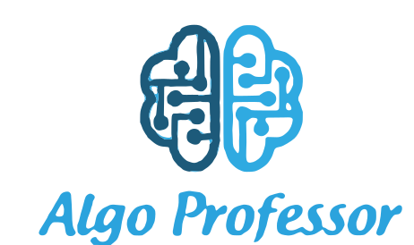

<p align="center"></p>

<h1 align="center">Enterprise Programming Languages Curriculum</h1>

<p align="center"><b>Python · Go · Rust · Scala · Java</b><br>Industry-aligned syllabus · Five courses · Five units each · Curriculum Edition 2026–27</p>

<p align="center">
  <a href="Programming_Languages_Syllabus.pdf"></a>
  <a href="latex/"></a>
  <a href="mailto:cto@algoprofessor.com"></a>
</p>

Companion to the [Enterprise AI Product Development Curriculum](../README.md). Modern AI products are polyglot: Python for models and agents, Go and Java for services, Scala for large data pipelines and Rust for the fast, safe core. These five courses build engineers who can work across every layer.

Every course has **five units**, each ending in a **hands-on outcome**; **45 lecture + 30 lab hours** (L–T–P–C 3–0–2–4) with **8 labs**; **five course outcomes mapped to Bloom levels** for OBE, NBA and NAAC; an **enterprise capstone**; **recommended industry certifications** (checked November 2026); and a **2026–2035 engineering outlook**.

## Courses at a Glance

| # | Code | Course | Focus | Capstone |
|:-:|:--|:--|:--|:--|
| 1 | `EPL-201` | [Python Programming for AI & Enterprise](#course-1) | From Pythonic fundamentals to production AI services, data pipelines and agents | AI-Powered Business Insights Service |
| 2 | `EPL-202` | [Go Programming for Cloud-Native Systems](#course-2) | Simple, fast, concurrent services for cloud platforms, DevOps and AI infrastructure | Cloud-Native AI Gateway Platform |
| 3 | `EPL-203` | [Rust Programming for Safe Systems](#course-3) | Memory-safe, high-performance software for systems, security, edge and AI infrastructure | Secure High-Performance Inference Service |
| 4 | `EPL-204` | [Scala Programming for Big Data & Functional Systems](#course-4) | Functional programming on the JVM for data platforms, streaming and reliable distributed services | Real-Time Financial Data Platform |
| 5 | `EPL-205` | [Java Programming for Enterprise & AI Applications](#course-5) | Modern Java, Spring Boot microservices and AI-enabled enterprise systems | AI-Enabled Enterprise Commerce Platform |

<a id="course-1"></a>

## 1. Python Programming for AI & Enterprise (`EPL-201`)

_From Pythonic fundamentals to production AI services, data pipelines and agents_ · **Prerequisites:** Basic programming logic, computer fundamentals · **Hours:** 45 L + 30 P

| Unit | Title | Hands-on outcome |
|:-:|:--|:--|
| I | **Python Foundations and Pythonic Thinking** | Builds a command-line expense tracker with file storage, input validation and error handling, packaged as a module. |
| II | **Object-Oriented, Functional and Typed Python** | Delivers a typed library-management package with dataclasses, decorators, 90% pytest coverage and a clean Ruff/mypy report. |
| III | **Data, Scientific Python and Concurrency** | Produces a sales-analytics pipeline in Polars + DuckDB with charts, and an asyncio web scraper benchmarked against a threaded version. |
| IV | **Web APIs and AI Engineering with Python** | Ships a FastAPI service with JWT auth that serves an ML model and an LLM-powered assistant using tool calls and a Python MCP server. |
| V | **Production Python: Performance, Packaging and Security** | Publishes a versioned package to a private index with a Rust-accelerated hot path, Docker image, CI pipeline and a clean pip-audit report. |

<details><summary><b>Unit topics</b></summary>

- **Unit I, Python Foundations and Pythonic Thinking:** Python 3 runtime and interpreters; variables, data types and operators; control flow; functions, arguments and scope; strings, lists, tuples, sets and dictionaries; comprehensions; files and context managers; exceptions; modules and packages; virtual environments and the uv/pip toolchain; Jupyter and VS Code workflows.
- **Unit II, Object-Oriented, Functional and Typed Python:** Classes, inheritance, composition, dunder methods and dataclasses; protocols and abstract base classes; iterators, generators and decorators; functional tools (map, filter, functools, itertools); type hints, generics and static checking (mypy/pyright); unit testing with pytest, fixtures and mocking; code quality with Ruff.
- **Unit III, Data, Scientific Python and Concurrency:** NumPy arrays and vectorisation; pandas and Polars for data wrangling; visualisation with Matplotlib and Plotly; SQL access with SQLAlchemy and DuckDB; concurrency models: threads, the GIL and free-threaded Python, multiprocessing, asyncio; profiling with cProfile and memory tools.
- **Unit IV, Web APIs and AI Engineering with Python:** HTTP and REST; FastAPI routing, dependency injection and async endpoints; Pydantic data validation; authentication (OAuth2, JWT); background tasks and queues (Celery, Redis); calling ML models and LLM APIs; structured outputs and tool calling; building retrieval-augmented and agent applications; MCP servers in Python.
- **Unit V, Production Python: Performance, Packaging and Security:** Project layout and pyproject.toml; packaging and publishing wheels; dependency locking; performance: vectorisation, Numba, Cython and Rust extensions via PyO3; logging and observability; Docker images for Python; CI/CD with GitHub Actions; security: secrets, dependency scanning (pip-audit), SBOMs and secure coding.

</details>

**Course outcomes:** CO1 (L2 Understand) Explain Python's data model, runtime and idiomatic constructs. · CO2 (L3 Apply) Apply object-oriented, functional and typed programming with automated tests. · CO3 (L4 Analyse) Analyse data and choose the right concurrency model for a workload. · CO4 (L3 Apply) Build secure web APIs and AI/LLM applications in Python. · CO5 (L6 Create) Create a packaged, optimised, secure and deployable Python product.

**Capstone:** **AI-Powered Business Insights Service:** a FastAPI platform that ingests company data with Polars, serves forecasts from an ML model, answers questions through an LLM agent with tool calls, and ships as a tested, containerised, security-scanned package with CI/CD.

**Careers:** Python Developer, AI / ML Engineer, Data Engineer, Backend Engineer, Automation Engineer, Agentic AI Developer

| Certification | Issuer | Level | Units |
|:--|:--|:--|:-:|
| PCEP – Certified Entry-Level Python Programmer | OpenEDG Python Institute | Entry | I |
| PCAP – Certified Associate Python Programmer | OpenEDG Python Institute | Associate | I–III |
| PCPP1 / PCPP2 – Certified Professional Python Programmer | OpenEDG Python Institute | Professional | II–V |
| Databricks Certified Associate Developer for Apache Spark (Python) | Databricks | Associate | III |
| NPTEL/SWAYAM: The Joy of Computing using Python | IIT faculty, Govt. of India | Academic | I, II |

**2026–2035 outlook:** **AI, ML & agents:** First choice for model building, LLM applications, agents and evaluation; expected to remain the language of AI. · **Data & analytics:** Core language for data pipelines, notebooks and analytics, alongside SQL. · **Automation & DevOps:** Scripting, testing, infrastructure automation and AI-driven operations. · **Performance trend:** Free-threaded Python and Rust extensions (PyO3) close the speed gap for production workloads.

<a id="course-2"></a>

## 2. Go Programming for Cloud-Native Systems (`EPL-202`)

_Simple, fast, concurrent services for cloud platforms, DevOps and AI infrastructure_ · **Prerequisites:** One programming language, networking basics · **Hours:** 45 L + 30 P

| Unit | Title | Hands-on outcome |
|:-:|:--|:--|
| I | **Go Foundations** | Builds a log-file analyser CLI that parses large files with slices and maps and reports errors with wrapping. |
| II | **Types, Interfaces, Generics and Testing** | Delivers a generic, interface-based inventory library with table-driven tests, fuzz tests and benchmarks. |
| III | **Concurrency in Go** | Builds a concurrent web crawler with a worker pool, rate limiting and context cancellation that passes the race detector. |
| IV | **Network Services and Microservices** | Ships a REST + gRPC order microservice on PostgreSQL with middleware, graceful shutdown and Prometheus metrics. |
| V | **Cloud-Native Go and AI Infrastructure** | Deploys a Kubernetes operator and an LLM API gateway in Go with caching, rate limits, pprof profiling and a clean govulncheck scan. |

<details><summary><b>Unit topics</b></summary>

- **Unit I, Go Foundations:** Go philosophy and toolchain (go build, run, fmt, vet); packages and modules; variables, constants and basic types; control flow; functions, multiple returns and closures; arrays, slices and maps; strings, runes and UTF-8; pointers; explicit error values and wrapping.
- **Unit II, Types, Interfaces, Generics and Testing:** Structs, methods and embedding; interfaces and implicit satisfaction; type switches; generics with type parameters and constraints; package design and visibility; table-driven unit tests, benchmarks and fuzzing; examples and documentation; dependency management with Go modules.
- **Unit III, Concurrency in Go:** Goroutines and the Go scheduler; channels (buffered, unbuffered) and select; worker pools, pipelines and fan-in/fan-out; context for cancellation and deadlines; sync.Mutex, WaitGroup, Once and atomics; errgroup; race detection; common concurrency bugs and how to avoid them.
- **Unit IV, Network Services and Microservices:** net/http servers, routing and middleware; JSON APIs; gRPC and Protocol Buffers; database access with database/sql and pgx; configuration and graceful shutdown; authentication; structured logging (slog); metrics and tracing with OpenTelemetry and Prometheus.
- **Unit V, Cloud-Native Go and AI Infrastructure:** Container-friendly Go builds (static binaries, distroless images); Kubernetes client-go and operators; CLI tools with Cobra; profiling with pprof and performance tuning; security (govulncheck, secrets, TLS); Go for AI infrastructure: LLM gateways, vector-search services and MCP servers.

</details>

**Course outcomes:** CO1 (L2 Understand) Explain Go's design, types, slices, maps and error model. · CO2 (L3 Apply) Apply interfaces, generics and testing to build reusable packages. · CO3 (L4 Analyse) Analyse and build correct concurrent programs with goroutines and channels. · CO4 (L3 Apply) Build observable HTTP and gRPC microservices with persistent storage. · CO5 (L6 Create) Create cloud-native Go tools and AI infrastructure services for Kubernetes.

**Capstone:** **Cloud-Native AI Gateway Platform:** a Go platform that routes, caches and rate-limits requests to several LLM providers, exposes REST and gRPC APIs, runs on Kubernetes with an operator for configuration, and provides full metrics and tracing.

**Careers:** Go Backend Engineer, Cloud-Native Engineer, Site Reliability Engineer, Platform / DevOps Engineer, AI Infrastructure Engineer

| Certification | Issuer | Level | Units |
|:--|:--|:--|:-:|
| Certified Kubernetes Application Developer (CKAD) | CNCF / Linux Foundation | Professional | V |
| Certified Kubernetes Administrator (CKA) | CNCF / Linux Foundation | Professional | V |
| Google Cloud Professional Cloud Developer | Google Cloud | Professional | IV, V |
| HashiCorp Certified: Terraform Associate | HashiCorp | Associate | V |
| GitHub portfolio assessment (no official Go language exam exists) | AlgoProfessor / institution | Project-based | I–V |

**2026–2035 outlook:** **Cloud-native platforms:** Kubernetes, Docker, Terraform and much of the cloud-native ecosystem are written in Go; expected to stay central. · **Microservices & APIs:** Fast, low-memory services with simple deployment as single binaries. · **AI infrastructure:** Gateways, agent hosting, vector-search services and MCP servers that must be reliable at scale. · **DevOps & SRE:** CLIs, automation and observability tooling.

<a id="course-3"></a>

## 3. Rust Programming for Safe Systems (`EPL-203`)

_Memory-safe, high-performance software for systems, security, edge and AI infrastructure_ · **Prerequisites:** C or any compiled language, data structures · **Hours:** 45 L + 30 P

| Unit | Title | Hands-on outcome |
|:-:|:--|:--|
| I | **Rust Foundations and Ownership** | Builds a text-statistics CLI with Cargo that processes files using borrowed slices and passes Clippy with no warnings. |
| II | **Types, Traits and Error Handling** | Delivers a bank-ledger library modelled with enums and traits, typed errors and full unit and integration tests. |
| III | **Collections, Iterators and Smart Pointers** | Builds a fast CSV analytics engine with iterator chains and smart pointers, benchmarked with Criterion against a Python version. |
| IV | **Fearless Concurrency, Async and Interoperability** | Ships a Tokio-based concurrent TCP chat server and a PyO3 extension that speeds up a Python hot loop. |
| V | **Production Rust: Web, WebAssembly, Embedded and AI** | Deploys an Axum REST service with SQLx, a WebAssembly front-end module and an on-device inference demo, with a clean cargo-audit report. |

<details><summary><b>Unit topics</b></summary>

- **Unit I, Rust Foundations and Ownership:** Why Rust: memory safety, performance and security; rustup, Cargo and crates.io; variables, mutability and data types; functions and control flow; ownership, moves and copies; references and borrowing; slices; the stack and the heap; reading compiler errors as guidance.
- **Unit II, Types, Traits and Error Handling:** Structs and methods; enums and pattern matching; Option and Result; error handling with ?, thiserror and anyhow; traits, trait objects and generics; lifetimes in functions and structs; modules, crates and workspaces; unit, integration and documentation tests.
- **Unit III, Collections, Iterators and Smart Pointers:** Vec, String, HashMap and BTreeMap; iterators and closures; iterator adapters for zero-cost data processing; Box, Rc, Arc, RefCell and interior mutability; Deref and Drop; macros (declarative); performance measurement with Criterion; idiomatic API design.
- **Unit IV, Fearless Concurrency, Async and Interoperability:** Threads, message passing and shared state with Mutex and Arc; Send and Sync; Rayon for data parallelism; async/await and the Tokio runtime; async I/O and networking; unsafe Rust and its rules; FFI with C; Python extensions with PyO3 and maturin.
- **Unit V, Production Rust: Web, WebAssembly, Embedded and AI:** Web services with Axum and SQLx; WebAssembly with wasm-bindgen; embedded Rust (embedded-hal, Embassy) on microcontrollers; AI and ML in Rust (Candle, Burn, ONNX Runtime bindings); observability with tracing; supply-chain security (cargo-audit, cargo-deny); Rust in the Linux kernel and safety-critical industries.

</details>

**Course outcomes:** CO1 (L2 Understand) Explain ownership, borrowing and lifetimes and why they guarantee memory safety. · CO2 (L3 Apply) Apply enums, traits, generics and error handling to model real problems. · CO3 (L4 Analyse) Analyse performance and write efficient code with iterators and smart pointers. · CO4 (L3 Apply) Build safe concurrent, async and cross-language (FFI, PyO3) components. · CO5 (L6 Create) Create production Rust services for web, WebAssembly, embedded or AI targets.

**Capstone:** **Secure High-Performance Inference Service:** a Rust platform with an Axum API, Tokio-based request batching, an ONNX/Candle model runtime, a PyO3 module for data scientists and a WebAssembly client, delivered with fuzz tests and supply-chain checks.

**Careers:** Rust Systems Engineer, Backend / Infrastructure Engineer, Embedded Software Engineer, Security Engineer, WebAssembly Developer, AI Infrastructure Engineer

| Certification | Issuer | Level | Units |
|:--|:--|:--|:-:|
| LFEL1002: Getting Started with Rust (exam-based badge) | Linux Foundation | Foundational | I, II |
| LFD480: Programming in Rust (course certificate and badge) | Linux Foundation | Advanced | I–V |
| Courses from Rust Foundation Trusted Training providers | Rust Foundation accredited providers | Course certificate | I–V |
| Ardan Labs Rust certification (vendor exam) | Ardan Labs | Professional | II–IV |

**2026–2035 outlook:** **Memory-safe systems:** Security guidance increasingly favours memory-safe languages for new critical code; Rust is the leading choice. · **AI infrastructure:** Tokenisers, inference engines, data engines (Polars) and vector databases. · **Edge, embedded & automotive:** Safe firmware and safety-critical components. · **WebAssembly & blockchain:** Browser, serverless and smart-contract platforms.

<a id="course-4"></a>

## 4. Scala Programming for Big Data & Functional Systems (`EPL-204`)

_Functional programming on the JVM for data platforms, streaming and reliable distributed services_ · **Prerequisites:** Java or Python, SQL basics · **Hours:** 45 L + 30 P

| Unit | Title | Hands-on outcome |
|:-:|:--|:--|
| I | **Scala 3 Foundations on the JVM** | Builds a student-records application with case classes, enums and traits, using a Java library from Scala. |
| II | **Functional Programming in Scala** | Delivers a pure-functional order-validation module with ADTs, Either-based errors and ScalaCheck property tests. |
| III | **Collections, Effects and Concurrency** | Builds a concurrent file-processing pipeline in Cats Effect with fs2 streaming and safe resource handling. |
| IV | **Big Data with Apache Spark** | Ships a Spark-Scala lakehouse job that processes millions of transactions, plus a Structured Streaming fraud-alert pipeline from Kafka. |
| V | **Production Scala: Services, Streaming and Data Platforms** | Deploys a containerised http4s service on Kafka and PostgreSQL with full tests and a Spark job orchestrated on a schedule. |

<details><summary><b>Unit topics</b></summary>

- **Unit I, Scala 3 Foundations on the JVM:** Scala and the JVM; sbt and scala-cli; expressions, values and types; methods and functions; classes, objects and traits; case classes and companion objects; Scala 3 syntax (indentation, enums, extension methods); string interpolation; interoperability with Java libraries.
- **Unit II, Functional Programming in Scala:** Immutability and pure functions; higher-order functions and currying; algebraic data types and pattern matching; Option, Either and Try for safe error handling; recursion and tail calls; type classes with givens and using clauses; for-comprehensions; property-based testing with ScalaCheck.
- **Unit III, Collections, Effects and Concurrency:** Immutable and mutable collections; lazy views; Futures and Promises; effect systems: Cats Effect IO and ZIO; resource safety, fibers and structured concurrency; streaming with fs2 / ZIO Streams; the actor model with Apache Pekko (Akka fork).
- **Unit IV, Big Data with Apache Spark:** Spark architecture (driver, executors, DAG); RDDs, DataFrames and Datasets in Scala; Spark SQL and Catalyst optimiser; partitioning, joins and performance tuning; Delta Lake / Iceberg tables; Spark Structured Streaming with Kafka; Spark MLlib pipelines.
- **Unit V, Production Scala: Services, Streaming and Data Platforms:** HTTP services with http4s, ZIO HTTP or Play; JSON with Circe; database access with Doobie/Skunk; Kafka producers and consumers; Apache Flink stream processing concepts; testing (MUnit, ScalaTest, Testcontainers); packaging, Docker and deployment; observability and JVM tuning.

</details>

**Course outcomes:** CO1 (L2 Understand) Explain Scala 3's type system, syntax and JVM interoperability. · CO2 (L3 Apply) Apply functional programming to model domains safely. · CO3 (L3 Apply) Build concurrent, resource-safe programs with effect systems and actors. · CO4 (L4 Analyse) Analyse and optimise large-scale Spark batch and streaming jobs. · CO5 (L6 Create) Create production Scala data platforms and services.

**Capstone:** **Real-Time Financial Data Platform:** Kafka ingestion, Spark Structured Streaming for fraud detection, Delta Lake storage, and a functional http4s API serving risk scores, built with typed, tested Scala and deployed in containers.

**Careers:** Big Data Engineer, Scala Developer, Spark Engineer, Streaming Engineer, Functional Programmer (FinTech), Data Platform Engineer

| Certification | Issuer | Level | Units |
|:--|:--|:--|:-:|
| Databricks Certified Associate Developer for Apache Spark | Databricks | Associate | IV |
| Databricks Certified Data Engineer Associate / Professional | Databricks | Assoc./Prof. | IV, V |
| Confluent Certified Developer for Apache Kafka | Confluent | Associate | IV, V |
| Functional Programming in Scala Specialization | EPFL (Coursera) | Course certificate | I–III |
| AWS Certified Data Engineer – Associate | AWS | Associate | IV, V |

**2026–2035 outlook:** **Big data engines:** Spark, Kafka-based systems and many data platforms are built on the JVM; Scala skills help with core engine work. · **Streaming & FinTech:** Type-safe, functional code for real-time, high-reliability financial systems. · **Functional programming:** Its ideas (immutability, ADTs, effects) shape modern Java, Kotlin, Rust and TypeScript. · **Data for AI:** Large-scale feature pipelines and data preparation for AI products.

<a id="course-5"></a>

## 5. Java Programming for Enterprise & AI Applications (`EPL-205`)

_Modern Java, Spring Boot microservices and AI-enabled enterprise systems_ · **Prerequisites:** Basic programming logic, computer fundamentals · **Hours:** 45 L + 30 P

| Unit | Title | Hands-on outcome |
|:-:|:--|:--|
| I | **Java Foundations and Object-Oriented Programming** | Builds a console banking system with full OOP design, custom exceptions and a Maven build. |
| II | **Modern Java: Generics, Collections, Lambdas and Streams** | Delivers an employee-analytics module using records, sealed types and the Stream API, with JUnit 5 tests. |
| III | **Concurrency, the JVM and Performance** | Builds a high-throughput order processor comparing platform and virtual threads, profiled with JFR and tuned GC. |
| IV | **Enterprise Java with Spring Boot** | Ships a secured Spring Boot e-commerce API with JPA, PostgreSQL, OAuth2/JWT and Testcontainers integration tests. |
| V | **Cloud-Native and AI-Enabled Java** | Deploys Kafka-connected Spring Boot microservices on Kubernetes with a GraalVM native image and a Spring AI RAG assistant. |

<details><summary><b>Unit topics</b></summary>

- **Unit I, Java Foundations and Object-Oriented Programming:** JDK, JVM and JRE; compilation and bytecode; data types, operators and control flow; arrays and strings; classes, objects, constructors, encapsulation, inheritance, polymorphism and abstraction; interfaces; packages and the module system; exception handling; build tools (Maven, Gradle).
- **Unit II, Modern Java: Generics, Collections, Lambdas and Streams:** Generics and bounded types; the Collections Framework (List, Set, Map, Queue); equals, hashCode and Comparable; lambdas, functional interfaces and method references; Stream API and collectors; Optional; records, sealed classes and pattern matching for switch; text blocks; unit testing with JUnit 5 and Mockito.
- **Unit III, Concurrency, the JVM and Performance:** Threads, executors and CompletableFuture; virtual threads (Project Loom) and structured concurrency; synchronisation, locks and concurrent collections; memory model; JVM internals: class loading, JIT, garbage collectors (G1, ZGC); profiling with JDK Flight Recorder; I/O and NIO.
- **Unit IV, Enterprise Java with Spring Boot:** Dependency injection and Spring Core; Spring Boot 3; REST APIs with Spring Web; validation; data access with Spring Data JPA and Hibernate; transactions; Spring Security with OAuth2/JWT; testing with Spring Boot Test and Testcontainers; API documentation (OpenAPI).
- **Unit V, Cloud-Native and AI-Enabled Java:** Microservices patterns; messaging with Apache Kafka; caching with Redis; observability with Micrometer and OpenTelemetry; Docker, Kubernetes and GraalVM native images; AI in Java: Spring AI and LangChain4j for LLM calls, RAG and tool use; security and dependency scanning (OWASP Dependency-Check).

</details>

**Course outcomes:** CO1 (L2 Understand) Explain the JVM, object-oriented principles and Java's type system. · CO2 (L3 Apply) Apply generics, collections, lambdas and streams in modern Java. · CO3 (L4 Analyse) Analyse concurrency and JVM performance and tune applications. · CO4 (L3 Apply) Build secure, tested Spring Boot services with persistence. · CO5 (L6 Create) Create cloud-native, AI-enabled Java microservices.

**Capstone:** **AI-Enabled Enterprise Commerce Platform:** Spring Boot microservices for catalogue, orders and payments connected by Kafka, secured with OAuth2, deployed on Kubernetes with native images, and a Spring AI assistant that answers customer and staff questions from company data.

**Careers:** Java Developer, Spring Boot Microservices Engineer, Full-Stack Java Developer, Enterprise Solutions Architect, Android / JVM Developer, AI-Enabled Backend Engineer

| Certification | Issuer | Level | Units |
|:--|:--|:--|:-:|
| Oracle Certified Professional: Java SE 21 Developer (1Z0-830) | Oracle | Professional | I–III |
| Oracle Certified Professional: Java SE 17 Developer (1Z0-829) | Oracle | Professional | I–III |
| Spring Certified Professional 2024 (exam 2V0-72.22) | Broadcom (VMware Tanzu) | Professional | IV |
| Certified Kubernetes Application Developer (CKAD) | CNCF / Linux Foundation | Professional | V |
| NPTEL/SWAYAM: Programming in Java | IIT faculty, Govt. of India | Academic | I, II |

**2026–2035 outlook:** **Enterprise systems:** Banking, insurance, telecom, e-commerce and government systems run on Java; expected to stay the enterprise backbone. · **Modern Java:** Twice-yearly releases and LTS versions (21, 25) keep adding productivity and performance features. · **AI in the enterprise:** Spring AI and LangChain4j bring LLMs and agents into existing Java systems. · **Cloud & big data:** Native images, Kubernetes and JVM data engines (Kafka, Flink, Spark).

## Build the PDF

```bash
cd programming-languages/latex
xelatex main.tex && xelatex main.tex
cp main.pdf ../Programming_Languages_Syllabus.pdf
cd ../.. && python3 scripts/make_lang_readme.py   # refresh this README
```

The book uses Times New Roman when installed (TeX Gyre Termes otherwise), a white Indian-tricolour cover and navy-and-gold pages.

## For Universities

AlgoProfessor helps institutions adopt this curriculum: syllabus customisation, faculty development programmes, programming and cloud labs, GitHub course repositories, industry capstones, certification readiness, accreditation support and placement readiness.

**Vice-Chancellors, Deans and HoDs:** contact **[cto@algoprofessor.com](mailto:cto@algoprofessor.com)** · [www.algoprofessor.com](https://www.algoprofessor.com) · [campus.algoprofessor.com](https://campus.algoprofessor.com)

---

**Dr S Satyanarayana** Ph.D., PDF(AI), FARSC · Agentic AI Scientist · Founder & CEO, AlgoProfessor · Creator of AlgoLang · AlgoProfessor AI R&D Solutions, Hyderabad

<p align="center"><sub>© 2026 Dr S Satyanarayana, AlgoProfessor AI R&amp;D Solutions. All rights reserved.</sub></p>
